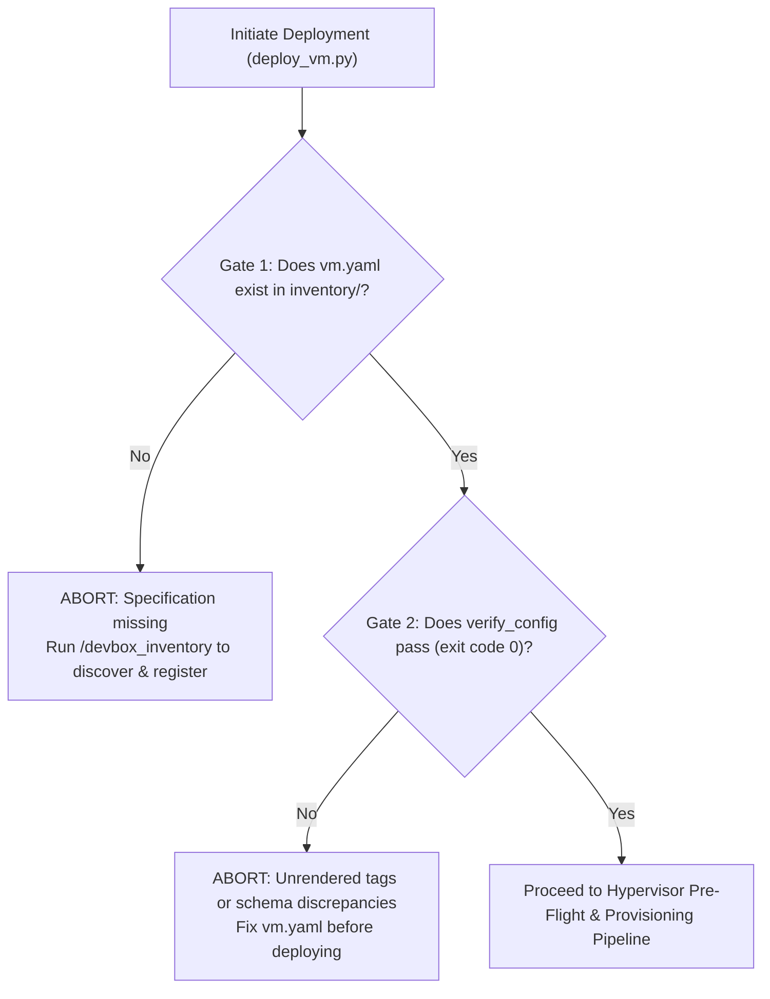

# DevBox VM Deployment Skill (`devbox_deploy`)

The `devbox_deploy` skill automates provisioning, launching, and managing dedicated DevBox execution virtual machines specified in `inventory/{vmhost}/{vm}/vm.yaml` (SSOT), with `inventory/{vmhost}/{vm}/VM.md` as supplementary documentation.

It provisions the guest virtual machine on the designated hypervisor (local KVM or remote physical host via SSH) and establishes zero-friction connectivity from your workstation.

---

## Directory Structure

```text
.agents/skills/devbox_deploy/
├── SKILL.md                          # Skill definition and reference
└── scripts/
    └── deploy_vm.py                  # Provisioning orchestrator and lifecycle engine
```

---

## Mandatory Pre-Requisite Gates

To prevent accidental deployments of unconfigured, malformed, or incomplete environments, `deploy_vm.py` **strictly enforces two pre-flight gates** before any network or hypervisor operation is attempted:



1. **Gate 1: Configuration Existence Check (SSOT)**:
   * Evaluates the VM operational specification (`inventory/{vmhost}/{vm}/vm.yaml`).
   * If missing, halts immediately and instructs the user to run `devbox_inventory`.
2. **Gate 2: Configuration & Runbook Validation Check**:
   * Validates YAML syntax and checks for unrendered template placeholders (`{{ VARIABLE }}`).
   * If supplementary runbook `VM.md` exists, validates it via [`verify_config.py`](../devbox_configure/scripts/verify_config.py).

---

## Deployment Pipeline Stages

Once the prerequisite gates pass, `deploy_vm.py` executes the automated pipeline:

1. **Structured Parameter Loading**:
   * Directly extracts domain name, hypervisor host, vCPUs, RAM, disk specs, static IP, MAC address, credentials, and proxy ports from `inventory/{vmhost}/{vm}/vm.yaml`.
2. **Workstation Access Preparation**:
   * Generates a dedicated ED25519 SSH keypair (`~/.ssh/devbox_vm_ed25519`) if not already present.
   * Configures `Host <vm_name>` in your local `~/.ssh/config` (including transparent `ProxyJump` for remote hypervisors).
3. **Libvirt Static DHCP Reservation**:
   * Registers a static DHCP host entry (`<host mac='...' name='...' ip='...'/>`) in libvirt's `default` virtual network (`virbr0`) idempotently.
4. **Base Image & Disk Overlay**:
   * Locates cached cloud images on the hypervisor (or downloads Ubuntu 24.04 minimal cloud image).
   * Creates a fast copy-on-write `qcow2` overlay of the specified disk size.
5. **Cloud-Init NoCloud Seed Generation**:
   * Generates `meta-data` and `user-data` injecting primary user, secondary admin, authorized SSH keys, Docker runtime, and `qemu-guest-agent`.
   * Packages them into a NoCloud CD-ROM seed ISO using `cloud-localds`.
6. **Domain Provisioning (`virt-install`)**:
   * Launches the VM domain with UEFI bootloader, host-passthrough CPU mode, and VirtIO networking.
7. **Hypervisor Port Forwarder (`systemd-socket-proxyd`)**:
   * Configures and enables `/etc/systemd/system/devbox-proxy.socket` on the hypervisor to route physical LAN traffic to the VM's internal application port with **zero processes running on your development workstation**.
8. **Persistent Landing Page Service (`devbox-landing.service`)**:
   * Installs and activates a lightweight systemd service inside the VM serving a modern status dashboard on `index.html`.
   * Ensures that `http://<hypervisor>:<proxy_port>/` is immediately browsable in any browser upon deployment until project workloads run on the port.
9. **End-to-End Proxy Validation (HTTP Roundtrip Verification)**:
   * From your development workstation, requests the root URL `http://<hypervisor>:<proxy_port>/` through the hypervisor proxy.
   * Verifies the HTTP 200 OK response, page title, and roundtrip latency, confirming that the VM is online and the entire multi-tier proxy pipeline is functional.
10. **Pristine Snapshot Creation**:
   * Polls SSH connectivity until the VM is online and cloud-init has finished.
   * Creates a pristine baseline disk snapshot (`snapshot-base-clean`) for instant disaster rollback.
11. **Automated Inventory Synchronization**:
   * Automatically registers the newly provisioned VM in `inventory/{vmhost}/{vm}/vm.yaml` via `devbox_inventory`.
   * Refreshes the hypervisor host record in `inventory/{vmhost}/vmhost.yaml`.
   * On `--purge`, cleans up the VM directory in `inventory/{vmhost}/{vm}/` and refreshes host records.

---

## Usage

### 1. Dry-Run (Preview Plan Without Executing)

Simulates the entire deployment plan, displaying all generated commands and configurations:

```bash
python3 .agents/skills/devbox_deploy/scripts/deploy_vm.py --dry-run
```

### 2. Pre-Flight Verification Only

Verifies that prerequisite gates and hypervisor connectivity pass without provisioning:

```bash
python3 .agents/skills/devbox_deploy/scripts/deploy_vm.py --check-only
```

### 3. End-to-End Proxy Roundtrip Validation

Tests end-to-end communication by requesting the root URL via the hypervisor proxy:

```bash
python3 .agents/skills/devbox_deploy/scripts/deploy_vm.py --validate-proxy
```

### 4. Deploy the Virtual Machine

Executes the full automated provisioning pipeline:

```bash
# Interactive confirmation prompt:
python3 .agents/skills/devbox_deploy/scripts/deploy_vm.py

# Non-interactive / CI mode:
python3 .agents/skills/devbox_deploy/scripts/deploy_vm.py --yes
```

---

## VM Lifecycle & Power Management

`deploy_vm.py` also provides full day-2 lifecycle operations for the deployed VM:

```bash
# Check live domain status, snapshots, SSH reachability, and proxy status:
python3 .agents/skills/devbox_deploy/scripts/deploy_vm.py --status

# Power on the VM:
python3 .agents/skills/devbox_deploy/scripts/deploy_vm.py --start

# Graceful shutdown:
python3 .agents/skills/devbox_deploy/scripts/deploy_vm.py --stop

# Force terminate (if unresponsive):
python3 .agents/skills/devbox_deploy/scripts/deploy_vm.py --destroy

# Entirely remove the VM (destroy, undefine, remove NVRAM and delete all disks):
python3 .agents/skills/devbox_deploy/scripts/deploy_vm.py --purge

# Reboot:
python3 .agents/skills/devbox_deploy/scripts/deploy_vm.py --reboot
```

---

## AI Agent Integration

AI coding assistants can trigger deployment using the slash command:

```text
/devbox_deploy
```
