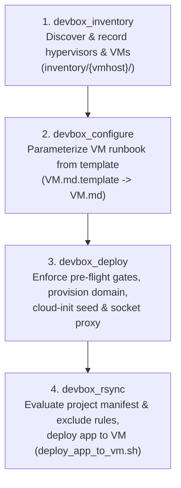

# DevBox Architecture & Security Model

This document outlines the architectural principles, isolation boundaries, and security model enforced by DevBox.

---

## 1. Two-Tier Host Topology

DevBox enforces a strict separation of concerns between code authoring and workload execution:

### Tier 1: Development Workstation
* **Responsibility**: Software development, source code authoring, version control (`git`), documentation, and IDE tooling.
* **Invariant**: Zero execution of heavy or untrusted runtime workloads. Automated crawler loops, headless browser automation, untrusted test suites, and container fleets are never run directly on the development machine.

### Tier 2: Dedicated Execution Hypervisor
* **Responsibility**: Dedicated physical server or isolated local hypervisor executing hardware-accelerated Linux KVM (`/dev/kvm`).
* **Function**: Hosts the guest virtual machines, provides bridged network traffic, and isolates guest execution environments from local workstations.

---

## 2. Resource Isolation & Proportional Sizing

To prevent guest execution environments from overwhelming hypervisor resources:

* **vCPU Capacity**: The provisioning engine dynamically measures available host CPU threads and allocates balanced core counts (typically 50% of host capacity), leaving remaining cores reserved for the host OS.
* **Memory Allocation**: Guest RAM is budgeted proportionally (~25% of total host RAM) across standardized memory tiers (2 GB, 4 GB, 8 GB, 16 GB, 32 GB), preventing out-of-memory kernel panics on shared physical hosts.
* **Storage Thin Provisioning**: Virtual machine disk images use the `qcow2` format, enabling dynamic copy-on-write allocation and rapid baseline snapshots (`virsh snapshot-create-as`).

---

## 3. Network Architecture & Service Access

```text
Local Workstation                  Hypervisor Host               Dedicated Guest VM
(Browser / Client)                 (remote-host / localhost)         (devbox-vm)
       |                                  |                             |
       |  HTTP :3001                      |                             |
       +--------------------------------->|  systemd-socket-proxyd      |
       |                                  |  Forward :3001 -> :3000     |
       |                                  +---------------------------->|  App Server (:3000)
       |                                  |                             |
```

* **Internal Guest Network**: The guest VM resides on an isolated libvirt virtual network bridge (`virbr0`) with private static DHCP leasing.
* **Zero Workstation Process Forwarding**: Web applications running inside the guest VM (e.g. port `3000`) are made accessible to physical LAN devices via a persistent systemd socket forwarder (`systemd-socket-proxyd`) running on the hypervisor host on port `3001`. This eliminates the need for developers to run local background SSH tunnels on their laptops.

---

## 4. Security & Safety Invariants

1. **Ephemeral Execution**: Staging credentials, test API tokens, and headless browser sessions reside exclusively inside the execution memory of the virtual machine.
2. **Snapshot Baseline & Instant Rollback**: Developers can create clean disk baselines before running experimental container builds or crawler jobs:
   ```bash
   virsh snapshot-create-as --domain <vm-name> --name snapshot-base-clean --disk-only
   ```
   If testing produces clutter or modified dependencies, the environment can be restored to its pristine baseline state within seconds.

---

## 5. Agent Skills Lifecycle Architecture

DevBox provides four complementary, composable skills for autonomous AI agents and command-line automation. The workflow operates as an automated lifecycle:



### Stage 1: Discovery & Documentation (`devbox_inventory`)
* **Role**: Inspects physical or local hypervisors via SSH or local libvirt, documenting hardware specifications, libvirt virtual networks, storage pools, and existing virtual machine domains.
* **Artifacts**: Maintains structured YAML records (`inventory/{vmhost}/vmhost.yaml` and `inventory/{vmhost}/{vm}/vm.yaml`).

### Stage 2: Configuration & Sizing (`devbox_configure`)
* **Role**: Parameterizes the single source-of-truth template (`VM.md.template`) to produce an operational runbook (`VM.md`).
* **Heuristics**: Calculates proportional vCPU and RAM allocations, ensures collision-free static IP and MAC assignments, and maps proxy forwarding ports.

### Stage 3: Provisioning & Lifecycle Management (`devbox_deploy`)
* **Role**: Enforces mandatory verification gates before hypervisor execution, generates cloud-init NoCloud ISO seeds, provisions KVM domains via `virt-install`, configures static DHCP reservations, and establishes persistent systemd socket proxying.
* **Lifecycle**: Provides full lifecycle commands (`--start`, `--stop`, `--status`, `--snapshot`, `--rollback`, `--validate-proxy`).

### Stage 4: Workload Deployment (`devbox_rsync`)
* **Role**: Evaluates project manifests (`package.json`, `requirements.txt`, etc.) and dynamically builds an optimized application deployment script (`deploy_app_to_vm.sh`).
* **Boundary**: Strictly excludes local developer caches, IDE state, documentation, agent configs, and version control directories, ensuring only necessary runtime application code reaches the execution VM.
