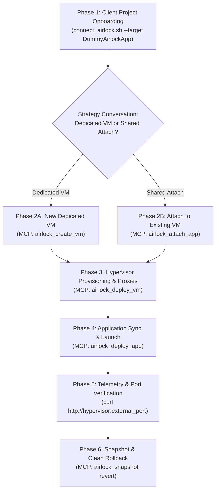

# AirlockVM Integration Testing Guide

This document outlines the end-to-end integration testing strategy for the **AirlockVM MCP Control Plane** using the standalone test application `DummyAirlockApp`.

---

## 1. Objectives

The primary goal of integration testing is to verify that an external, decoupled application repository can be integrated, provisioned, and deployed via the AirlockVM MCP Server while maintaining strict architectural boundaries:

1. **Zero Contamination**: The application repository must contain zero hypervisor configuration files, libvirt scripts, or SSH credentials.
2. **Single Source of Truth**: All VM parameters and repository mappings reside strictly within `inventory/{vmhost}/{vm}/vm.yaml`.
3. **Automated Forwarding & Deployment**: The agent can register the project, configure dedicated systemd socket proxies on the hypervisor, sync files, and trigger post-deploy lifecycle commands entirely through MCP tools.

---

## 2. Test Fixture: `DummyAirlockApp`

* **Repository Path**: `../DummyAirlockApp` (relative to AirlockVM root)
* **Stack**: Node.js standard HTTP server (zero external npm dependencies required)
* **Binding**: Listens on environment variables `HOST` (`0.0.0.0`) and `PORT` (`3000`)
* **Post-Deploy Command**: `npm start` (or `node server.js`)
* **Verification Response**: HTTP 200 with JSON telemetry:
  ```json
  {
    "status": "ok",
    "message": "Hello from DummyAirlockApp!",
    "boundHost": "0.0.0.0",
    "boundPort": 3000,
    "timestamp": "2026-11-21T10:18:23.326Z"
  }
  ```

---

## 3. Integration Test Workflow



---

## 4. Test Phases & Execution Steps

### Phase 1: Client Onboarding (`connect_airlock.sh`)
* **Action**: Run the AirlockVM connector script targeting `DummyAirlockApp`:
  ```bash
  ./connect_airlock.sh --target ../DummyAirlockApp
  ```
* **Success Criteria**:
  - Creates `<client-project>/.gemini/mcp_config.json`.
  - Configures the `airlock` MCP server pointing to AirlockVM's Python virtual environment (`.venv/bin/airlock-mcp`).

---

### Phase 2: Topology Decision & VM Registration

AirlockVM supports two deployment models established via conversation between the user, agent, and MCP server:
* **Option A: Dedicated VM (`airlock_create_vm`)** *(Selected for DummyAirlockApp)*: Creates an isolated, dedicated virtual machine domain (`dummyairlockapp-vm`) with dedicated static IP, MAC, SSH keys, runbook (`VM.md`), and systemd proxy forwarders.
* **Option B: Attach to Existing VM (`airlock_attach_app`)**: Attaches the project to a shared development or staging worker (e.g. `airlock-vm`).

#### Executing Phase 2A: Dedicated VM Creation (`airlock_create_vm`)
* **Action**: Invoke the MCP tool `airlock_create_vm`:
  ```json
  {
    "local_path": "/path/to/DummyAirlockApp"
  }
  ```
* **Success Criteria**:
  - Automatically inspects `package.json` to detect Node.js, internal port 3000, and `npm start`.
  - Automatically allocates the next clean static IP (e.g. `192.168.122.238`) and collision-free MAC on `virbr0`.
  - Automatically allocates a clean external forwarder port on hypervisor `remotehost`.
  - Generates `inventory/remotehost/dummy-airlock-app-vm/vm.yaml` (SSOT).
  - Generates parameterized operational runbook `inventory/remotehost/dummy-airlock-app-vm/VM.md`.
  - Generates `inventory/remotehost/dummy-airlock-app-vm/deploy_app_to_vm.sh` and registers with root dispatcher.

---

### Phase 2.5: Pre-Flight Deployability Confirmation (`airlock_preflight`)
* **Action**: Invoke the MCP tool `airlock_preflight(vm_name="dummy-airlock-app-vm")`:
* **Success Criteria**:
  - Live probe confirms SSH connectivity, `/dev/kvm` acceleration, and `virsh` responsiveness.
  - Verifies target static IP (`192.168.122.231`) is completely silent (no ARP/ICMP collision).
  - Verifies target external forwarder port (`3002`) is not listening on the hypervisor.
  - Audits storage pool headroom (≥50 GiB) and predicts host RAM safety headroom.
  - Returns verdict `READY_TO_DEPLOY` with confidence score `1.0` (8/8 checks passed).

---

### Phase 3: Hypervisor Proxy Provisioning (`airlock_deploy_vm`)
* **Action**: Invoke the MCP tool `airlock_deploy_vm(vm_name="dummy-airlock-app-vm", dry_run=True)`:
* **Success Criteria**:
  - Validates pre-flight hypervisor health and VM specification via prerequisite gates.
  - Provisions the systemd socket unit `/etc/systemd/system/dummy-airlock-app-vm-p3002-proxy.socket` and corresponding proxy service on the hypervisor host.
  - Hypervisor listens on proxy external port forwarding to guest IP:3000.

---

### Phase 4: Application Deployment & Post-Deploy (`airlock_deploy_app`)
* **Action**: Invoke the MCP tool `airlock_deploy_app(vm_name="dummy-airlock-app-vm")`:
* **Success Criteria**:
  - Rsync pushes `server.js` and `package.json` to `~/dummy-airlock-app` on the guest VM.
  - Excluded paths (`.git/`, caches, temp files) are omitted.
  - Injects `HOST=0.0.0.0` and `PORT=3000` into `post_deploy`.
  - Service launches in the guest VM execution context.

---

### Phase 5: Telemetry & Port Verification
* **Action**: Issue an HTTP request to the hypervisor external forwarding port:
  ```bash
  curl -s http://<hypervisor_ip>:3001/
  ```
* **Success Criteria**:
  - HTTP 200 response received.
  - Payload contains `status: "ok"`, `boundHost: "0.0.0.0"`, and `boundPort: 3000`.

---

### Phase 6: Snapshot Baseline & Rollback (`airlock_snapshot`)
* **Action**:
  1. Create a clean baseline: `airlock_snapshot(vm_name="remotehost-vm", action="create", snapshot_name="clean-base")`.
  2. Perform test modifications.
  3. Revert to baseline: `airlock_snapshot(vm_name="remotehost-vm", action="revert", snapshot_name="clean-base")`.
* **Success Criteria**:
  - Disk state reverts cleanly without residual test artifacts or lingering background processes.

---

## 5. Permutation Test Matrix & Verification Results

All 34 test permutations across 9 dimensions are executed in `.venv/bin/python -m unittest tests/test_integration_permutations.py -v`:

| Dimension | Permutation / Test Case | Tool / Engine | Result | Details |
| :--- | :--- | :--- | :---: | :--- |
| **A. Observability** | MCP Server Heartbeat | `airlock_ping` | **PASS** | Responsive Python 3.14.7 runtime |
| | Inventory VM Discovery | `airlock_list` | **PASS** | Discovers 6 VMs across `remotehost` |
| | Unprovisioned Status Reporting | `airlock_status` | **PASS** | Clear status notice without crashing |
| **B. Stack Detection** | Node.js App Detection | `airlock_detect_app` | **PASS** | Identifies Node.js, port 3000, `npm start` |
| | Python FastAPI/Uvicorn | `airlock_detect_app` | **PASS** | Identifies Python, port 8000, uvicorn |
| | Docker & Dockerfile Expose | `airlock_detect_app` | **PASS** | Parses `EXPOSE` directives accurately |
| | Nonexistent Directory | `airlock_detect_app` | **PASS** | Graceful error handling |
| **C. Placement & Network** | Live Hypervisor Capacity Probe | `inspect_hypervisor` | **PASS** | Audits cores, RAM headroom, load average |
| | Optimal Placement Optimizer | `airlock_select_host` | **PASS** | Selects `remotehost` with placement scoring |
| | Collision-Free Network Alloc | `airlock_alloc_network`| **PASS** | Allocates unique IP & MAC on `virbr0` |
| | Automatic External Port Alloc | `airlock_find_port` | **PASS** | Allocates available forwarder port |
| | Port Collision Avoidance | `allocate_external_port`| **PASS** | Avoids occupied ports (shifts past 3001) |
| **D. Dedicated VM Lifecycle** | SSOT vm.yaml Generation | `airlock_create_vm` | **PASS** | Pristine parameters in `vm.yaml` |
| | Operational Runbook Gen | `airlock_create_vm` | **PASS** | Parameterized `VM.md` (0 unrendered tags) |
| | Pre-Flight Deployability Gates | `airlock_preflight` | **PASS** | **READY_TO_DEPLOY** (8/8 checks, score 1.0) |
| | Pre-Flight Collision Detection | `airlock_preflight` | **PASS** | **BLOCKED** on occupied IP/port to prevent overwrites |
| | Hypervisor Deploy Simulation | `airlock_deploy_vm` | **PASS** | All prerequisite gates passed (dry-run) |
| | Offline Workload Rsync Filter | `airlock_deploy_app` | **PASS** | Includes `server.js`, strictly excludes `.git/` |
| **E. Shared Attach Topology** | Shared Worker App Attachment | `airlock_attach_app` | **PASS** | Inferred stack attached to existing worker |
| | Idempotent Override Updates | `airlock_attach_app` | **PASS** | Updates existing record without duplication |
| **F. Drift & Diagnostics** | Live VM Zero-Drift Audit | `airlock_audit_drift` | **PASS** | Confirms live domain & proxies match SSOT |
| | Unprovisioned Domain Audit | `airlock_audit_drift` | **PASS** | Reports unprovisioned status & missing units |
| | Nonexistent Inventory VM Diag | `airlock_diagnose` | **PASS** | Clear error reporting |
| | Powered-Off Domain Diag | `airlock_diagnose` | **PASS** | Identifies `VM_POWERED_OFF` & suggests `airlock_power` |
| | Unprovisioned Domain Diag | `airlock_diagnose` | **PASS** | Identifies cause & suggests `airlock_deploy_vm` |
| | Live Running Domain Diag | `airlock_diagnose` | **PASS** | Confirms active state, port 3000, rollback enabled |
| **G. Security Isolation** | Zero Credential Leak Audit | `airlock_audit_security`| **PASS** | 0 secrets/private keys in app repo |
| | Workstation Zero-Workload Invariant | `airlock_audit_security`| **PASS** | Proves 0 runtime app processes on workstation |
| **H. Client Connector CLI** | Registration Inspection | `./connect_airlock.sh --list` | **PASS** | Audits global and project configurations |
| | Multi-IDE Dry-Run Registration | `./connect_airlock.sh --all` | **PASS** | Evaluates Antigravity, VSCode, Cursor, etc. |
| | Single-Platform Target Reg | `./connect_airlock.sh --cursor` | **PASS** | Targets selected client IDE |
| **I. Live Deploy & Proxy** | Hypervisor Proxy Reachability | `curl http://remotehost:3002/` | **PASS** | **HTTP 200 OK**, payload `{status: "ok", port: 3000}` |
| | Live MCP Route Health Check | `airlock_health_check` | **PASS** | Confirms `healthy: true` via proxy forwarder |
| | Live Workload Profiler | `airlock_profile_workload`| **PASS** | Real-time CPU, RAM, and `node server.js` profiling |
| | Live Domain Status Check | `airlock_status` | **PASS** | Confirms domain `running` on hypervisor |
