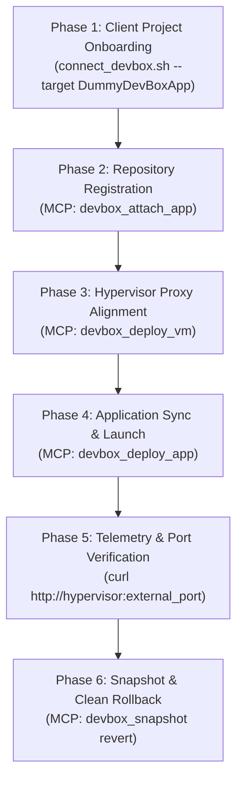

# DevBox Integration Testing Guide

This document outlines the end-to-end integration testing strategy for the **DevBox MCP Control Plane** using the standalone test application `DummyDevBoxApp`.

---

## 1. Objectives

The primary goal of integration testing is to verify that an external, decoupled application repository can be integrated, provisioned, and deployed via the DevBox MCP Server while maintaining strict architectural boundaries:

1. **Zero Contamination**: The application repository must contain zero hypervisor configuration files, libvirt scripts, or SSH credentials.
2. **Single Source of Truth**: All VM parameters and repository mappings reside strictly within `inventory/{vmhost}/{vm}/vm.yaml`.
3. **Automated Forwarding & Deployment**: The agent can register the project, configure dedicated systemd socket proxies on the hypervisor, sync files, and trigger post-deploy lifecycle commands entirely through MCP tools.

---

## 2. Test Fixture: `DummyDevBoxApp`

* **Repository Path**: `../DummyDevBoxApp` (relative to DevBox root)
* **Stack**: Node.js standard HTTP server (zero external npm dependencies required)
* **Binding**: Listens on environment variables `HOST` (`0.0.0.0`) and `PORT` (`3000`)
* **Post-Deploy Command**: `npm start` (or `node server.js`)
* **Verification Response**: HTTP 200 with JSON telemetry:
  ```json
  {
    "status": "ok",
    "message": "Hello from DummyDevBoxApp!",
    "boundHost": "0.0.0.0",
    "boundPort": 3000,
    "timestamp": "2026-11-21T10:18:23.326Z"
  }
  ```

---

## 3. Integration Test Workflow



---

## 4. Test Phases & Execution Steps

### Phase 1: Client Onboarding (`connect_devbox.sh`)
* **Action**: Run the DevBox connector script targeting `DummyDevBoxApp`:
  ```bash
  ./connect_devbox.sh --target ../DummyDevBoxApp
  ```
* **Success Criteria**:
  - Creates `<client-project>/.gemini/mcp_config.json`.
  - Configures the `devbox` MCP server pointing to DevBox's Python virtual environment (`.venv/bin/devbox-mcp`).

---

### Phase 2: Repository Registration (`devbox_attach_app`)
* **Action**: Invoke the MCP tool `devbox_attach_app`:
  ```json
  {
    "vm_name": "barkley-vm",
    "app_name": "DummyDevBoxApp",
    "local_path": "/path/to/DummyDevBoxApp",
    "internal_port": 3000,
    "external_port": 3001,
    "post_deploy": "npm start"
  }
  ```
* **Success Criteria**:
  - `inventory/barkley/barkley-vm/vm.yaml` is updated under `repositories:`.
  - `inventory/barkley/barkley-vm/deploy_app_to_vm.sh` is regenerated with the new repository target and port mappings.
  - Root dispatcher `deploy_app_to_vm.sh` reflects the updated VM configuration.

---

### Phase 3: Hypervisor Proxy Provisioning (`devbox_deploy_vm`)
* **Action**: Invoke the MCP tool `devbox_deploy_vm(vm_name="barkley-vm")`:
* **Success Criteria**:
  - Validates pre-flight hypervisor health and VM state.
  - Provisions the systemd socket unit `/etc/systemd/system/barkley-vm-p3001-proxy.socket` and corresponding proxy service on the hypervisor host.
  - Hypervisor listens on port `3001` forwarding to guest IP `192.168.122.x:3000`.

---

### Phase 4: Application Deployment & Post-Deploy (`devbox_deploy_app`)
* **Action**: Invoke the MCP tool `devbox_deploy_app(vm_name="barkley-vm", app_name="DummyDevBoxApp")`:
* **Success Criteria**:
  - Rsync pushes `server.js` and `package.json` to `~/DummyDevBoxApp` on the guest VM.
  - Excluded paths (`.git/`, caches, temp files) are omitted.
  - Injects `HOST=0.0.0.0` and `PORT=3000` into `post_deploy`.
  - Service launches in the guest VM execution context.

---

### Phase 5: Telemetry & Port Verification
* **Action**: Issue an HTTP request to the hypervisor external forwarding port:
  ```bash
  curl -s http://<hypervisor_ip>:3001/
  ```
* **Success Criteria**:
  - HTTP 200 response received.
  - Payload contains `status: "ok"`, `boundHost: "0.0.0.0"`, and `boundPort: 3000`.

---

### Phase 6: Snapshot Baseline & Rollback (`devbox_snapshot`)
* **Action**:
  1. Create a clean baseline: `devbox_snapshot(vm_name="barkley-vm", action="create", snapshot_name="clean-base")`.
  2. Perform test modifications.
  3. Revert to baseline: `devbox_snapshot(vm_name="barkley-vm", action="revert", snapshot_name="clean-base")`.
* **Success Criteria**:
  - Disk state reverts cleanly without residual test artifacts or lingering background processes.

---

## 5. Automated Verification Checklist

| Test Item | Command / Tool | Expected Result | Pass / Fail |
| :--- | :--- | :--- | :--- |
| **MCP Ping** | `devbox_ping` | `DevBox MCP Server is online (Python 3.14)` | [ ] |
| **Connector** | `connect_devbox.sh` | Generates valid `.gemini/mcp_config.json` | [ ] |
| **Attach App** | `devbox_attach_app` | Updates `vm.yaml` and sync scripts | [ ] |
| **Dry-Run Deploy** | `devbox_deploy_app(dry_run=True)` | Excludes `.git`, calculates rsync file list | [ ] |
| **Proxy Forward** | `curl http://host:3001/` | Returns JSON status from guest VM | [ ] |
