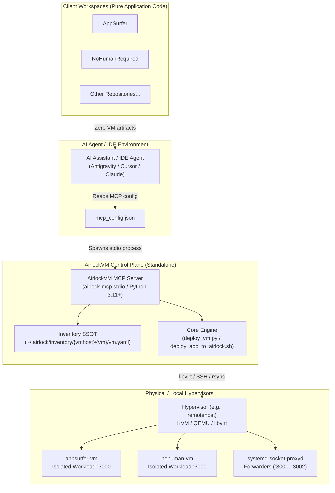

# AirlockVM Model Context Protocol (MCP) Server

This document outlines the architecture, tooling specification, integration model, and security boundaries of the **AirlockVM MCP Server**.

---

## 1. Overview & Motivation

As development workflows scale across multiple applications (e.g., crawler fleets, autonomous agents, heavy machine learning pipelines), embedding virtualization tooling, scripts, and hypervisor secrets directly into individual project repositories leads to configuration drift, duplicate maintenance, and security vulnerabilities.

AirlockVM addresses this by acting as a **centralized, standalone Infrastructure Control Plane**. Through the **Model Context Protocol (MCP)**, AirlockVM exposes high-level infrastructure tools to AI coding agents (such as Antigravity, Claude Code, Cursor, and custom agent harnesses) without requiring client project repositories to carry hypervisor logic, SSH keys, or virtualization configs.



---

## 2. Runtime & Packaging

The AirlockVM MCP Server runs in an isolated Python virtual environment configured via modern PEP 621 packaging:

* **Python Runtime**: Python 3.11+ (`>=3.11`)
* **Packaging Specification**: [pyproject.toml](../pyproject.toml) managed with `hatchling`
* **MCP SDK**: `mcp>=2.3.0` (`mcp.server.mcpserver.MCPServer`)
* **Transport**: Standard I/O (`stdio`), enabling zero-network local agent execution with immediate lifecycle termination when the agent disconnects.
* **Console Entry Point**: `airlock-mcp` (points to `airlock.mcp.server:main`)
* **Standard Installation**: Run `./install_airlock_mcp.sh` to install `airlock-mcp` into `~/.local/bin/` via `uv tool` or `pipx`.

---

## 3. Tool Specification

The MCP server exposes standard, declarative tools enabling agents to inspect, deploy, sync, and manage execution virtual machines:

### 3.1. Inspection & Observability

| Tool Name | Parameters | Description |
| :--- | :--- | :--- |
| `airlock_list` | *(none)* | Discovers and lists all registered hypervisors and VMs across active inventory search paths (`~/.airlock/inventory/` or `$AIRLOCK_INVENTORY_DIR`), including their allocated IPs, mapped repositories, and external forwarding ports. |
| `airlock_list_hypervisors` | `live_probe: bool = False` | Enumerates all registered hypervisors from `vmhost.yaml` along with CPU cores, RAM headroom, storage pools, networks, and VM counts; optionally probes live RAM and CPU load. |
| `airlock_status` | `vm_name: str` | Queries the target VM's live status (`running`, `shut off`, etc.), current IP lease, uptime, and available disk snapshots. |
| `airlock_detect_app` | `local_path: str` | Intelligently inspects project manifests (`package.json`, `pyproject.toml`, `Cargo.toml`, `go.mod`, `compose.yaml`) to infer framework, internal port, and `post_deploy` command. |
| `airlock_health_check` | `vm_name: str`<br/>`app_name: str = ""` <br/>`path: str = "/"` | Probes the live hypervisor route with retries. If failing or crashing, automatically connects to the VM over SSH and captures runtime logs for instant diagnosis. |
| `airlock_diagnose` | `vm_name: str`<br/>`app_name: str = ""` | Multi-layer crash diagnostic engine: inspects guest journal logs, internal port listeners, hypervisor proxy sockets, and detects root causes with actionable remediation. |
| `airlock_audit_drift` | `vm_name: str` | Audits live hypervisor domain and systemd proxy state against inventory SSOT, detecting discrepancies in vCPU, RAM, MAC address, and state. |
| `airlock_reconcile` | `vm_name: str`<br/>`strategy: str = "refresh_inventory"` | Reconciles detected drift between inventory SSOT and live hypervisor. |
| `airlock_profile_workload` | `vm_name: str`<br/>`duration_sec: int = 2` | Measures real-time CPU, RAM, swap, and process load inside a running VM and computes rightsizing guidance to reclaim hypervisor resources. |
| `airlock_audit_security` | `vm_name: str`<br/>`app_name: str = ""` | Audits isolation boundaries: verifies zero secret/key leaks on guest VM, checks AppArmor confinement, and confirms zero workload processes on workstation. |
| `airlock_ping` | *(none)* | Health check verifying that the MCP server and Python runtime are responsive. |

### 3.2. Sizing, Placement & Network Automation

| Tool Name | Parameters | Description |
| :--- | :--- | :--- |
| `airlock_find_port` | `vm_name: str = ""` <br/>`internal_port: int = 3000`<br/>`preferred_port: int = 0`<br/>`vmhost: str = ""` | Audits both inventory reservations and live hypervisor TCP listening sockets over SSH to discover and return the next clean, conflict-free external proxy port. Auto-selects hypervisor if omitted. |
| `airlock_alloc_network` | `vmhost: str = ""` <br/>`network_name: str = "default"` | Audits libvirt network definitions and reservations, allocating the next available static IP and generating a collision-free MAC address (`52:54:00:xx:xx:xx`). Auto-detects hypervisor if omitted. |
| `airlock_select_host` | `required_vcpu: int = 2`<br/>`required_ram_mib: int = 2048`<br/>`required_disk_gb: int = 20` | Audits CPU, available RAM headroom, and running VMs across registered hypervisors to select the optimal host for placement. |

### 3.3. Lifecycle, Safety & Power Management

| Tool Name | Parameters | Description |
| :--- | :--- | :--- |
| `airlock_power` | `vm_name: str`<br/>`action: "start" \| "stop" \| "reboot" \| "destroy"` | Issues power state transitions via libvirt (`virsh start`, `virsh shutdown`, `virsh reboot`, `virsh destroy`). |
| `airlock_purge_vm` | `vm_name: str`<br/>`dry_run: bool = False`<br/>`purge_ssh_keys: bool = False` | Permanently removes a VM domain, NVRAM, disk/snapshot images, libvirt static DHCP reservation, proxy sockets, `~/.ssh/config` host block, and inventory record (regenerating the sync dispatcher). |
| `airlock_checkpoint` | `vm_name: str`<br/>`action: "create" \| "revert"`<br/>`snapshot_name: str = ""` | Creates automated pre-deployment disk snapshot checkpoints or reverts back to a clean state if experimental workloads crash. |
| `airlock_snapshot` | `vm_name: str`<br/>`action: "create" \| "revert" \| "list"`<br/>`snapshot_name: str = ""` | Manages disk-only snapshots (`virsh snapshot-create-as` / `virsh snapshot-revert`), enabling rapid clean-state rollbacks after running experimental workloads. |

### 3.4. Provisioning & Workload Deployment

| Tool Name | Parameters | Description |
| :--- | :--- | :--- |
| `airlock_create_vm` | `local_path: str`<br/>`vmhost: str = ""` <br/>`vm_name: str = ""` <br/>`app_name: str = ""` <br/>`internal_port: int = 0`<br/>`external_port: int = 0`<br/>`post_deploy: str = ""` <br/>`vcpu: int = 2`<br/>`memory_mib: int = 2048`<br/>`disk_gib: int = 20` | Generates a new dedicated execution virtual machine specification and runbook in `inventory/{vmhost}/{vm}/` for an application. Auto-detects stack/ports/commands, selects optimal hypervisor, caps vCPU safely below host capacity, allocates static IP/MAC and conflict-free proxy ports, and regenerates sync scripts. |
| `airlock_update_vm` | `vm_name: str`<br/>`vcpu: int = 0`<br/>`memory_mib: int = 0`<br/>`disk_size_gib: int = 0`<br/>`internal_port: int = 0`<br/>`external_port: int = 0`<br/>`post_deploy: str \| None = None`<br/>`include: list[str] \| None = None`<br/>`exclude: list[str] \| None = None`<br/>`app_name: str = ""` | Updates an existing VM's resources, ports, `post_deploy` command, or per-repo rsync `include`/`exclude` rules in `vm.yaml`, automatically updating `proxy_socket_service`, re-rendering `VM.md`, and regenerating sync scripts. |
| `airlock_attach_app` | `vm_name: str`<br/>`local_path: str`<br/>`app_name: str = ""` <br/>`internal_port: int = 0`<br/>`external_port: int = 0`<br/>`post_deploy: str = ""` | Registers or updates an application repository in an existing `inventory/{vmhost}/{vm}/vm.yaml`. Auto-detects stack/ports/commands if omitted, and auto-allocates conflict-free host ports. |
| `airlock_preflight` | `vm_name: str` | Non-destructive pre-flight deployability confirmation: live probe of SSH/sudo, /dev/kvm, libvirtd, IP silence, port conflicts, disk headroom, and host RAM safety. Returns verdict (`READY_TO_DEPLOY` / `BLOCKED`) with confidence score. |
| `airlock_deploy_vm` | `vm_name: str`<br/>`dry_run: bool = False` | Enforces pre-flight capability checks and provisions/updates the VM domain: SSH key generation, static DHCP reservations on `virbr0`, cloud-init NoCloud ISO seeding, `virt-install`, and hypervisor `systemd-socket-proxyd` forwarders for all mapped repository ports. |
| `airlock_deploy_app` | `vm_name: str`<br/>`app_name: str = ""` <br/>`dry_run: bool = False`<br/>`no_restart: bool = False`<br/>`offline: bool = False`<br/>`checkpoint: bool = False`<br/>`verify_health: bool = False` | Synchronizes application source code to the target VM using `deploy_app_to_airlock.sh`. Optionally creates safety snapshot checkpoints and verifies HTTP route health post-deploy. |
| `airlock_exec` | `vm_name: str`<br/>`command: str`<br/>`workdir: str = ""` <br/>`timeout: int = 120` | Executes build, test, or diagnostic shell commands inside the isolated guest VM over SSH using base64-safe transport and bounded timeouts. |
| `airlock_bake_image` | `vmhost: str = "localhost"`<br/>`force: bool = False`<br/>`dry_run: bool = False` | Pre-bakes a golden Ubuntu 24.04 `qcow2` base image (with Docker, Node.js, Python, and QEMU Guest Agent pre-installed) so new VMs skip cloud-init package downloads and boot to SSH in seconds. |

---

## 4. Connecting Client Projects to the MCP Server

Client projects connect to AirlockVM by registering the MCP server in their agent configuration.

### 4.1. Configuration (`mcp_config.json`)

To enable AirlockVM tools in any project or globally in Antigravity / Claude Code / Cursor:

```json
{
  "mcpServers": {
    "airlock": {
      "command": "/path/to/AirlockVM/.venv/bin/airlock-mcp"
    }
  }
}
```

Or using direct Python execution:

```json
{
  "mcpServers": {
    "airlock": {
      "command": "/path/to/AirlockVM/.venv/bin/python",
      "args": ["-m", "airlock.mcp.server"]
    }
  }
}
```

### 4.2. Automated Client Onboarding (`connect_airlock.sh`)

AirlockVM provides a helper script (`connect_airlock.sh`) to automatically register or remove the AirlockVM MCP Server across all major IDEs and AI agent harnesses without manual JSON editing:

* **Supported Platforms**: VS Code (`.vscode/mcp.json`), Antigravity / Gemini (`.gemini/mcp_config.json`), Cursor (`.cursor/mcp.json`), Claude (`.mcp.json` / `claude_desktop_config.json`), Windsurf (`.codeium/windsurf/mcp_config.json`), JetBrains (`.idea/mcp.json`), and universal root `.mcp.json`.

```bash
# Connect the current client project workspace (with interactive confirmation):
./connect_airlock.sh

# Connect all detected IDEs in a specific project workspace:
./connect_airlock.sh --target /path/to/AppSurfer --all

# Connect specific IDEs (e.g. VS Code & Antigravity):
./connect_airlock.sh --target /path/to/AppSurfer --vscode --antigravity

# Auto-approve without interactive prompt (useful in CI / automation):
./connect_airlock.sh --target /path/to/AppSurfer --yes

# Connect globally for the current user across all installed IDEs:
./connect_airlock.sh --global --all

# Inspect active AirlockVM registrations:
./connect_airlock.sh --list
```

---

## 5. Security Model & Isolation Boundaries

AirlockVM enforces strict security boundaries between the developer workstation, client codebases, and physical hypervisors:

1. **Clean Client Repositories**: Client application repositories contain zero hypervisor scripts, zero libvirt configurations, and zero SSH keys. Their `.gitignore` files remain standard and minimal.
2. **Private Inventory**: Hypervisor details, SSH access definitions, and guest configuration templates in `~/.airlock/inventory/` (or configured via `$AIRLOCK_INVENTORY_DIR`) are strictly local and decoupled from version control.
3. **Dedicated Port Proxying**: Workloads listening on internal guest ports (e.g. `3000`) are mapped on the hypervisor host via isolated `systemd-socket-proxyd` instances (`{vm_name}-p{ext_port}-proxy.socket`). The local workstation does not run background SSH tunnels or expose local ports.
4. **Principle of Least Privilege**: AI agents interacting with client applications only receive high-level MCP tool invocations (`airlock_deploy_app`, `airlock_status`). The agent does not need root credentials or raw SSH execution on hypervisor nodes.

---

## 6. Integration Testing & Permutation Coverage

Every tool and sub-engine exposed by the AirlockVM MCP Server is verified through an automated 40-permutation test suite (`tests/test_integration_permutations.py`) and deterministic unit tests (`tests/test_unit_mitigations.py`):

```bash
# Execute full MCP server permutation suite:
.venv/bin/python -m unittest tests/test_integration_permutations.py -v
```

See [Integration Testing Guide](INTEGRATION_TESTING.md) for full details on test fixtures, topologies, and verification criteria.
