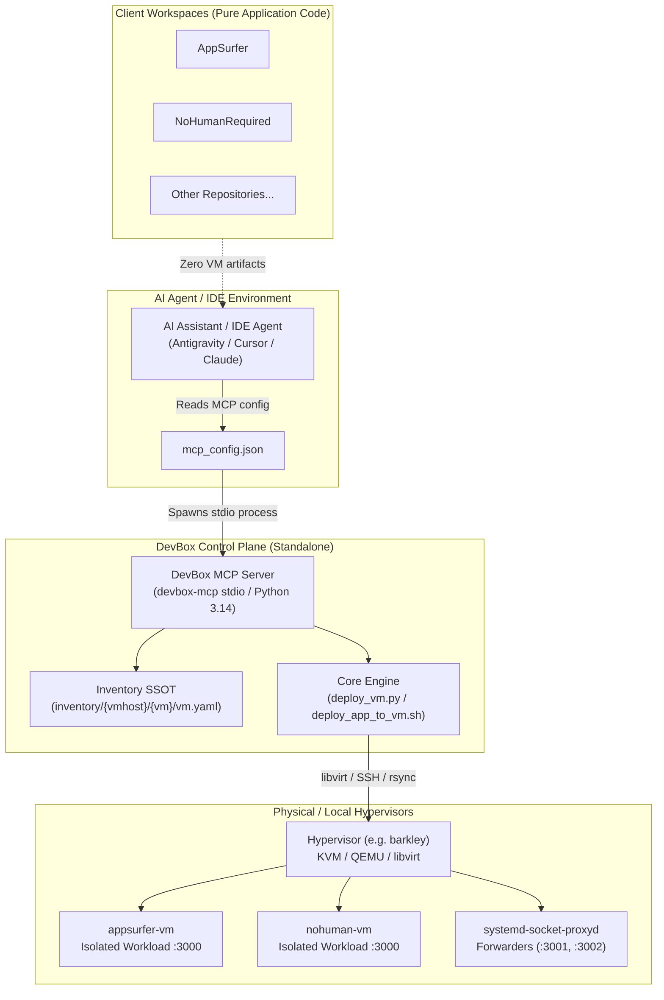

# DevBox Model Context Protocol (MCP) Server

This document outlines the architecture, tooling specification, integration model, and security boundaries of the **DevBox MCP Server**.

---

## 1. Overview & Motivation

As development workflows scale across multiple applications (e.g., crawler fleets, autonomous agents, heavy machine learning pipelines), embedding virtualization tooling, scripts, and hypervisor secrets directly into individual project repositories leads to configuration drift, duplicate maintenance, and security vulnerabilities.

DevBox addresses this by acting as a **centralized, standalone Infrastructure Control Plane**. Through the **Model Context Protocol (MCP)**, DevBox exposes high-level infrastructure tools to AI coding agents (such as Antigravity, Claude Code, Cursor, and custom agent harnesses) without requiring client project repositories to carry hypervisor logic, SSH keys, or virtualization configs.



---

## 2. Runtime & Packaging

The DevBox MCP Server runs in an isolated Python virtual environment configured via modern PEP 621 packaging:

* **Python Runtime**: Python 3.14 (`>=3.14`)
* **Packaging Specification**: [pyproject.toml](../pyproject.toml) managed with `hatchling`
* **MCP SDK**: `mcp>=2.3.0` (`mcp.server.mcpserver.MCPServer`)
* **Transport**: Standard I/O (`stdio`), enabling zero-network local agent execution with immediate lifecycle termination when the agent disconnects.
* **Console Entry Point**: `devbox-mcp` (points to `devbox.mcp.server:main`)

---

## 3. Tool Specification

The MCP server exposes standard, declarative tools enabling agents to inspect, deploy, sync, and manage execution virtual machines:

### 3.1. Inspection & Observability

| Tool Name | Parameters | Description |
| :--- | :--- | :--- |
| `devbox_list` | *(none)* | Discovers and lists all registered hypervisors and VMs in the `inventory/` Single Source of Truth (SSOT), including their allocated IPs, mapped repositories, and external forwarding ports. |
| `devbox_status` | `vm_name: str` | Queries the target VM's live status (`running`, `shut off`, etc.), current IP lease, uptime, and available disk snapshots. |
| `devbox_ping` | *(none)* | Health check verifying that the MCP server and Python 3.14 runtime are responsive. |

### 3.2. Lifecycle & Power Management

| Tool Name | Parameters | Description |
| :--- | :--- | :--- |
| `devbox_power` | `vm_name: str`<br/>`action: "start" \| "stop" \| "reboot"` | Issues power state transitions via libvirt (`virsh start`, `virsh shutdown`, `virsh reboot`). |
| `devbox_snapshot` | `vm_name: str`<br/>`action: "create" \| "revert" \| "list"`<br/>`snapshot_name: str = ""` | Manages disk-only snapshots (`virsh snapshot-create-as` / `virsh snapshot-revert`), enabling rapid clean-state rollbacks after running experimental workloads. |

### 3.3. Provisioning & Workload Deployment

| Tool Name | Parameters | Description |
| :--- | :--- | :--- |
| `devbox_attach_app` | `vm_name: str`<br/>`app_name: str`<br/>`local_path: str`<br/>`internal_port: int`<br/>`external_port: int`<br/>`post_deploy: str = ""` | Registers or updates an application repository in `inventory/{vmhost}/{vm}/vm.yaml` under `repositories:`, defining internal/external port mappings, remote target paths, and `post_deploy` lifecycle hooks. |
| `devbox_deploy_vm` | `vm_name: str`<br/>`dry_run: bool = False` | Enforces pre-flight capability checks and provisions/updates the VM domain: SSH key generation, static DHCP reservations on `virbr0`, cloud-init NoCloud ISO seeding, `virt-install`, and hypervisor `systemd-socket-proxyd` forwarders for all mapped repository ports. |
| `devbox_deploy_app` | `vm_name: str`<br/>`app_name: str = ""` <br/>`dry_run: bool = False`<br/>`no_restart: bool = False`<br/>`offline: bool = False` | Synchronizes application source code to the target VM using `deploy_app_to_vm.sh`, automatically injecting `HOST=0.0.0.0` and `PORT=$internal_port` into post-deploy lifecycle hooks while excluding version control and local caches. |

---

## 4. Connecting Client Projects to the MCP Server

Client projects connect to DevBox by registering the MCP server in their agent configuration.

### 4.1. Configuration (`mcp_config.json`)

To enable DevBox tools in any project or globally in Antigravity / Claude Code / Cursor:

```json
{
  "mcpServers": {
    "devbox": {
      "command": "/path/to/DevBox/.venv/bin/devbox-mcp"
    }
  }
}
```

Or using direct Python execution:

```json
{
  "mcpServers": {
    "devbox": {
      "command": "/path/to/DevBox/.venv/bin/python",
      "args": ["-m", "devbox.mcp.server"]
    }
  }
}
```

### 4.2. Automated Client Onboarding (`connect_devbox.sh`)

DevBox provides a helper script (`connect_devbox.sh`) to automatically register or remove the DevBox MCP Server across all major IDEs and AI agent harnesses without manual JSON editing:

* **Supported Platforms**: VS Code (`.vscode/mcp.json`), Antigravity / Gemini (`.gemini/mcp_config.json`), Cursor (`.cursor/mcp.json`), Claude (`.mcp.json` / `claude_desktop_config.json`), Windsurf (`.codeium/windsurf/mcp_config.json`), JetBrains (`.idea/mcp.json`), and universal root `.mcp.json`.

```bash
# Connect all detected IDEs in a project workspace:
./connect_devbox.sh --target /path/to/AppSurfer --all

# Connect specific IDEs (e.g. VS Code & Antigravity):
./connect_devbox.sh --target /path/to/AppSurfer --vscode --antigravity

# Connect globally for the current user across all installed IDEs:
./connect_devbox.sh --global --all

# Inspect active DevBox registrations:
./connect_devbox.sh --list
```

---

## 5. Security Model & Isolation Boundaries

DevBox enforces strict security boundaries between the developer workstation, client codebases, and physical hypervisors:

1. **Clean Client Repositories**: Client application repositories contain zero hypervisor scripts, zero libvirt configurations, and zero SSH keys. Their `.gitignore` files remain standard and minimal.
2. **Private Inventory**: Hypervisor details, SSH access definitions, and guest configuration templates in `inventory/` are strictly local to DevBox and excluded from version control (`.gitignore`).
3. **Dedicated Port Proxying**: Workloads listening on internal guest ports (e.g. `3000`) are mapped on the hypervisor host via isolated `systemd-socket-proxyd` instances (`{vm_name}-p{ext_port}-proxy.socket`). The local workstation does not run background SSH tunnels or expose local ports.
4. **Principle of Least Privilege**: AI agents interacting with client applications only receive high-level MCP tool invocations (`devbox_deploy_app`, `devbox_status`). The agent does not need root credentials or raw SSH execution on hypervisor nodes.
