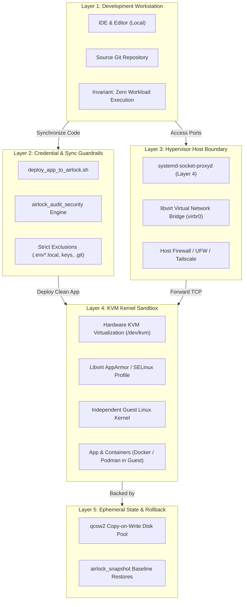

# AirlockVM Security & Proxy Isolation Model

This document specifies the security architecture, proxy mechanics, authentication boundaries, and defense-in-depth isolation layers enforced by **AirlockVM**.

---

## 1. Executive Summary & Proxy Authentication FAQ

### Is a password generated when the proxy is installed on the hypervisor?

> **No. `systemd-socket-proxyd` is an unauthenticated, transparent Layer 4 TCP proxy. It does not generate passwords, terminate TLS, or perform user authentication.**

When AirlockVM provisions a virtual machine and configures port forwarding on the hypervisor (`systemd-socket-proxyd`), it sets up a raw TCP stream forwarder at the operating system level:

```text
[Developer Workstation / Browser]
               │
               ▼  (HTTP / TCP: 3001)
┌────────────────────────────────────────────────────────┐
│ Hypervisor Host (localhost or remotehost)              │
│                                                        │
│  systemd Socket Unit: 0.0.0.0:3001                     │
│  systemd Service Unit: systemd-socket-proxyd           │
│                                                        │
│  * Transparent Layer 4 TCP stream forwarding           │
│  * NO password generation                              │
│  * NO TLS termination / certificate inspection         │
│  * NO HTTP header inspection or session tracking       │
└───────────────────────┬────────────────────────────────┘
                        │
                        ▼  (Internal TCP: 3000)
┌────────────────────────────────────────────────────────┐
│ Dedicated Guest Virtual Machine (virbr0: 192.168.122.x)│
│                                                        │
│  Application Server (listening on :3000)               │
│  * Application authentication (JWT, cookies, OAuth)    │
│  * Workload execution & database containers            │
└────────────────────────────────────────────────────────┘
```

### Where Does Authentication Live?

Because the hypervisor proxy forwards raw TCP packets transparently, authentication responsibility rests at two possible boundaries:

1. **Application Layer (Standard)**: The application running inside the guest VM (Node.js, Python, Go, Rust) handles user authentication (session cookies, JSON Web Tokens, OAuth2, or HTTP Basic Auth) on its own endpoints.
2. **Perimeter / Gateway Layer (Hardened)**: If the application itself has no built-in authentication (e.g., internal debug dashboards, raw API servers), access must be secured at the hypervisor host level using network firewall rules, loopback binding with SSH tunneling, or a reverse proxy gateway.

---

## 2. Default Network Exposure & Binding Architecture

When `airlock_deploy_vm` (or `deploy_vm.py`) sets up hypervisor port forwarding, the generated systemd socket unit (`/etc/systemd/system/{vm_name}-p{ext_port}-proxy.socket`) dynamically selects its binding interface based on the target hypervisor:

### 1. Localhost Deployments (`vmhost = localhost` or `127.0.0.1`)
```ini
[Socket]
ListenStream=127.0.0.1:3001
```
* **Strict Loopback Isolation**: Automatically binds exclusively to `127.0.0.1`.
* **Zero LAN Exposure**: Connections from external physical networks (Wi-Fi, Ethernet) are dropped by the Linux kernel. Only local processes and your local browser can access `http://localhost:3001`.

### 2. Remote Hypervisor Deployments (`vmhost = remotehost`)
```ini
[Socket]
ListenStream=0.0.0.0:3001
```
* **LAN / Network Reachable**: Binds to `0.0.0.0` so client workstations across the network can access `http://remotehost:3001`.
* **Lockdown Recommendation**: On untrusted physical LANs, apply the access lockdown patterns below (Loopback + SSH tunnel, UFW firewall, or reverse proxy auth gateway).

---

## 3. Hardening & Access Lockdown Patterns

Choose one of the following production or team development patterns depending on your operational requirements:

### Pattern A: Loopback Binding + SSH Tunnel (Maximum Isolation)

The most secure approach binds the proxy socket exclusively to the hypervisor's loopback interface (`127.0.0.1`), eliminating all LAN exposure:

1. **Modify the Socket Configuration on Hypervisor**:
   Edit `/etc/systemd/system/{vm_name}-p{ext_port}-proxy.socket`:
   ```ini
   [Socket]
   ListenStream=127.0.0.1:3001
   ```
   Apply the change:
   ```bash
   sudo systemctl daemon-reload
   sudo systemctl restart {vm_name}-p3001-proxy.socket
   ```

2. **Connect from Workstation via SSH Local Forwarding**:
   ```bash
   ssh -N -L 3001:127.0.0.1:3001 remotehost
   ```
   Now `http://localhost:3001` on your development laptop tunnels securely through encrypted SSH directly to the hypervisor's loopback interface, completely inaccessible to the rest of the LAN.

---

### Pattern B: Hypervisor Firewall Rules (LAN Whitelisting)

If you want direct browser access without running a local SSH tunnel, restrict incoming TCP traffic on the hypervisor using `ufw` or `nftables`:

```bash
# Allow access only from your specific workstation IP:
sudo ufw allow from 192.168.1.50 to any port 3001 proto tcp comment "AirlockVM Proxy"

# Deny all other incoming traffic to that port:
sudo ufw deny 3001/tcp
```

With `nftables` or `iptables`:
```bash
sudo iptables -A INPUT -p tcp --dport 3001 -s 192.168.1.50 -j ACCEPT
sudo iptables -A INPUT -p tcp --dport 3001 -j DROP
```

---

### Pattern C: Reverse Proxy with Auth Gateway (Caddy / Nginx / Traefik)

To provide password-protected or SSL/TLS-encrypted access to team members or remote developers, place a lightweight reverse proxy in front of the hypervisor proxy.

#### Example with Caddy (Automatic HTTPS + HTTP Basic Auth):

Install Caddy on the hypervisor and configure `/etc/caddy/Caddyfile`:

```caddyfile
app.internal.domain.com {
    # Generate bcrypt hash with: caddy hash-password
    basic_auth {
        developer $2a$14$Zkx19XLiW6VYouRHu...
    }

    reverse_proxy 127.0.0.1:3001
}
```

This terminates TLS, prompts for a username/password before any packets reach the VM, and proxies traffic downstream to `systemd-socket-proxyd`.

#### Example with Nginx + OAuth2 / Authelia:
For organizations requiring Google, GitHub, or Single Sign-On (SSO) credentials, route traffic through [OAuth2-Proxy](https://oauth2-proxy.github.io/oauth2-proxy/) or [Authelia](https://www.authelia.com/) before forwarding to the proxy socket.

---

### Pattern D: Mesh VPN Isolation (Tailscale / WireGuard)

For distributed teams or remote hypervisors accessible over the public internet, bind the socket unit directly to the hypervisor's Tailscale or WireGuard VPN IP:

```ini
[Socket]
# Bind ONLY to the hypervisor's Tailscale IP:
ListenStream=100.85.12.34:3001
```

Only authenticated devices on your private Tailscale tailnet or WireGuard network can reach the service. The physical Ethernet or public IP interface remains closed.

---

## 4. The 5-Layer Defense-in-Depth Isolation Model

AirlockVM operates on a defense-in-depth security model across five architectural boundaries:



---

### Layer 1: Development Workstation (Zero-Workload Invariant)

* **Principle**: The developer machine is strictly for source code authoring, git commits, and IDE interaction.
* **Invariant**: Heavy workloads, automated crawlers, untrusted packages, and database containers **never run on the workstation**.
* **Audit**: The `airlock_audit_security` tool inspects local processes to verify that node/python server processes are not executing locally.
* **Workstation Ports**: Zero background SSH tunnels or listening application ports run on the developer workstation.

---

### Layer 2: Credential Zero-Leak & Synchronization Guardrails

* **Differential Rsync Engine (`deploy_app_to_airlock.sh`)**: The synchronization script generated by `airlock_rsync` computes strict exclusion rules before pushing code to the execution VM.
* **Blocked Paths**:
  - Version control directories: `.git/`, `.svn/`, `.hg/`
  - Local developer environment files: `.env*.local`, `.env.production`
  - Private cryptographic keys: `*.pem`, `*.key`, `id_rsa`, `id_ed25519`
  - IDE & Agent state: `.idea/`, `.vscode/`, `.gemini/`, `.agents/`
  - Local build artifacts & caches: `node_modules/`, `__pycache__/`, `.venv/`, `dist/`, `target/`
* **Automated Audit**: `airlock_audit_security` executes remote checks on the guest VM to guarantee that zero private keys, `.git` histories, or `.env.local` files were accidentally copied to the VM filesystem.

---

### Layer 3: Hypervisor Boundary & Network Isolation

* **Isolated Virtual Network**: The guest VM resides on an internal virtual bridge (`virbr0`) with private static DHCP leasing (e.g., `192.168.122.x`). The VM has no public IP address and is not directly routeable from the internet.
* **Layer 4 Socket Multiplexing**: Instead of exposing the entire virtual machine or running complex VPN tunnels per app, the hypervisor forwards individual TCP ports using systemd socket units.
* **Process Separation**: The proxy runs under the hypervisor's `systemd-socket-proxyd` daemon, isolated from the guest operating system.

---

### Layer 4: KVM Hardware Virtualization & Kernel Boundary

* **Hardware-Assisted KVM (`/dev/kvm`)**: Unlike OS-level containers (Docker, LXC) which share the host kernel, AirlockVM guests run on dedicated virtual machine instances with an **independent Linux kernel**.
* **Container Escape Containment**: If an AI agent or application vulnerability triggers a container escape (such as `runc` or `containerd` zero-days), the attacker only breaks out into the **guest VM kernel**, not the physical host or development laptop.
* **Hypervisor Confinement**: Libvirt enforces AppArmor (`svirt_t` or `libvirt-<uuid>`) and SELinux isolation profiles on all QEMU processes, restricting access to unauthorized host storage or devices.

---

### Layer 5: Ephemeral State, Disk Baselines & Instant Rollback

* **Copy-on-Write (`qcow2`) Disks**: Virtual machine storage uses `qcow2` sparse files with dynamic allocation.
* **Pristine Snapshot Baselines**: Before running untrusted agent tasks, complex builds, or destructive test suites, take an instant snapshot:
  ```bash
  airlock snapshot <vm_name> create baseline-clean
  ```
* **Instant Rollback**: If packages or configurations become corrupted or untrusted state is introduced:
  ```bash
  airlock snapshot <vm_name> revert baseline-clean
  ```
  The disk state reverts immediately to the pristine baseline.

---

## 5. Security Audit Engine (`airlock_audit_security`)

AirlockVM includes an autonomous security auditing engine accessible via the CLI and the MCP control plane:

```bash
airlock audit-security <vm_name>
```

Or via MCP agent tool call:
```json
{
  "tool": "airlock_audit_security",
  "arguments": {
    "vm_name": "dummy-airlock-app-vm"
  }
}
```

### Audited Security Checks:

| Check | Target | Pass Condition | Severity on Failure |
| :--- | :--- | :--- | :--- |
| `secret_leak_audit` | Guest VM remote code directory | Zero `.git/`, `.env*.local`, `*.pem`, `*.key`, `id_rsa`, `id_ed25519` detected | **High** |
| `hypervisor_confinement` | Libvirt domain profile | Hypervisor AppArmor or SELinux confinement profile active | **Medium** |
| `workstation_zero_workload` | Local development host | Zero application servers (`server.js`, python web servers) executing locally | **Low (Warning)** |

---

## 6. Hardening Quick-Reference Checklist

| Hardening Objective | Recommended Implementation | Default Out-of-the-Box |
| :--- | :--- | :--- |
| **Proxy Authentication** | Application-level JWT / OAuth or Reverse Proxy with Basic Auth | Unauthenticated Layer 4 TCP proxy |
| **Proxy Network Binding** | Bind to `127.0.0.1` (SSH tunnel) or Tailscale IP (`100.x.y.z`) | `127.0.0.1` (localhost) / `0.0.0.0` (remotehost) |
| **Host Firewall** | UFW / nftables rule restricting port to workstation IP | Open to hypervisor's reachable LAN |
| **Secrets & Keys** | Excluded via `airlock_rsync` exclusion engine | Strictly excluded from guest sync |
| **Workstation Sandboxing** | All application processes execute in KVM guest | Zero workstation runtime processes |
| **Disaster Recovery** | Disk snapshot created prior to experimental workloads | Snapshot engine available via CLI / MCP |
